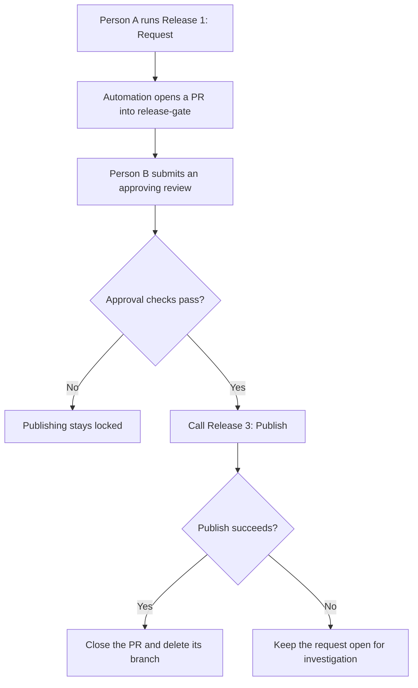

# Release Gate

**One person requests. Another approves. Merging is not a release strategy.**

A GitHub Actions release-approval template extracted from a working React Native / Expo setup. Someone requests a release, a different authorised person approves it, and only then can the publishing workflow run.

> **Bring your own app; keep the gate.** This template includes a sample build and a dry-run publishing step. It produces a text artifact—not an APK, AAB, or IPA—and uploads nothing to an app store. No surprise production releases included.

## What you get

- A manual release request with app and store-track choices.
- An automation-created pull request that records the request.
- Named release approvers and a self-approval check.
- A reusable publishing workflow reached through the approval workflow.
- A CI guard against adding another publishing trigger.
- Request cleanup after success, with the request left open after failure.

The approval mechanism is reusable beyond React Native, too.

## How it works

`release-gate` is a holding branch for release requests—not somewhere you merge application changes.

## Make it yours

1. **Start a repository** with **Use this template**, or bring the gate into your existing app.
2. **Configure your repository reference, approvers, apps, and tracks.**
3. **Give Actions the required access** and configure code owners before enforcing reviews.
4. **Try the included dry run**, then connect your real build and store upload.

Follow [SETUP.md](SETUP.md) for both adoption routes, exact file changes, permissions, and the first-run checklist.

> **Avoid locking yourself out:** add another eligible code owner with write access **before requiring code-owner approval**. PR authors cannot approve their own PRs. [Ownership setup and recovery considerations →](SETUP.md#5-configure-code-owners-before-enforcing-reviews)

## Using the gate

### Request a release

Open **Actions → Release 1: Request → Run workflow**, select the intended branch, app, and track, then run it. The bot opens a PR into `release-gate`; ask an authorised reviewer to review it.

### Approve a release

A different authorised person opens the request PR and submits **Review changes → Approve**. The gate checks the request before calling the publish workflow.

**Do not merge the request PR.** This is an approval queue, not a merge queue wearing a different hat.

- **Success:** the workflow closes the request and deletes its branch.
- **Failure:** the request stays open. Inspect the logs and, for real uploads, the store state before rerunning—a failed job does not guarantee nothing was uploaded.
- **Changed your mind?** Close an unapproved request without merging it.

## Before production

Protect the workflow files, request branches, and store credentials. Also define the exact source revision to build: the request records a commit, but the sample publish workflow does not explicitly check out that recorded commit.

The gate compares GitHub accounts; independent approval still requires a different human. Repository write access remains powerful, so the workflow is not a substitute for repository and environment protections.

See the [production checklist](SETUP.md#before-you-give-it-the-store-keys) before enabling real uploads.

## Documentation

- [Setup guide](SETUP.md): adoption, permissions, workflow reference, testing, and local checks.
- [Specification](SPEC.md): the exact gate rules and known limits.

## License

MIT. See [LICENSE](LICENSE).

---

  <b>Call us old-fashioned</b>  
  We just think shipping a broken binary to thousands of devices should take two people agreeing it's a good idea 

