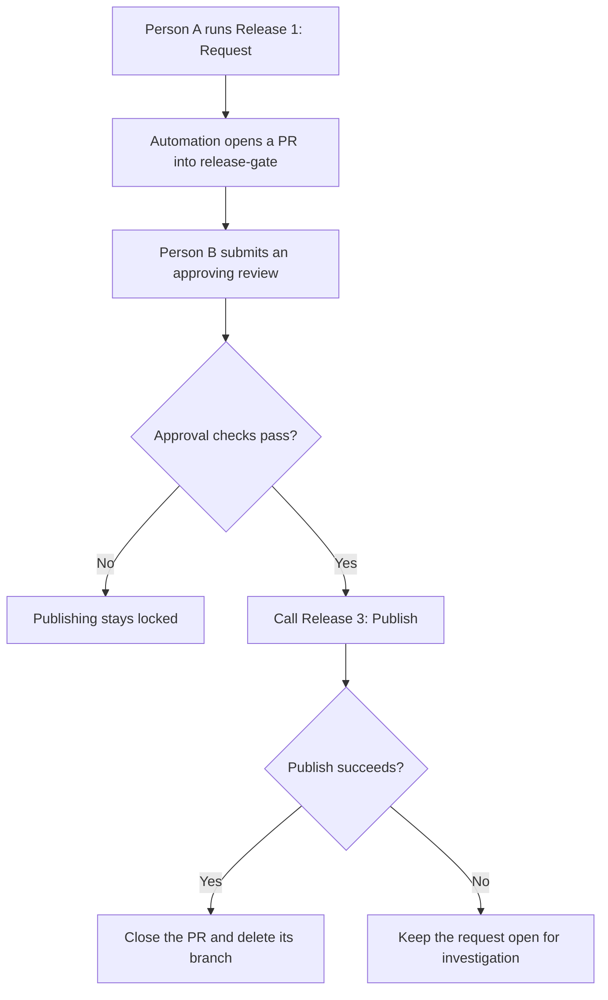

<h1 align="center">Release Gate</h1>

  <b>One person requests. Another approves. Merging is not a release strategy.</b>

 

 

A GitHub Actions release-approval template extracted from a working React Native / Expo setup. Someone requests a release, a different authorised person approves it, and only then can the publishing workflow run.

 

> [!IMPORTANT]
> **Born from production reality:** Forged from a real-world Poisoned Pipeline Execution (PPE) incident (OWASP CI/CD Top 10) where an attacker used a compromised credential to inject a rogue workflow and attempt to exfiltrate signing keys. In mobile CI/CD, a single token should never have the power to deploy backdoored binaries to user devices. Two authorized humans must sign off—always.  
> [Read the full threat model & retrospective →](THREAT_MODEL.md)

 

---

## What you get

- **Manual release requests:** Request releases with app and store-track choices via `workflow_dispatch`.
- **Automated audit trails:** An automation-created pull request records every request.
- **Named approvers & anti-self-approval:** Enforces independent peer reviews before publishing.
- **Protected publishing pipeline:** A reusable publishing workflow reached only through the approval gate.
- **CI trigger guards:** Automated checks that fail if a direct publish trigger is accidentally added.
- **Clean state management:** Auto-closes requests after success, leaving failed requests open for debugging.

The approval mechanism is modular and reusable beyond React Native, too.

 

---

## How it works

 

> **Bring your own app; keep the gate.**  
> This template includes a sample build and a dry-run publishing step. It produces a text artifact—not an APK, AAB, or IPA—and uploads nothing to an app store. No surprise production releases included.

 

---

## Make it yours

1. **Start a repository** with **Use this template**, or bring the gate into your existing app.
2. **Configure your repository reference, approvers, apps, and tracks.**
3. **Give Actions the required access** and configure code owners before enforcing reviews.
4. **Try the included dry run**, then connect your real build and store upload.

Follow [SETUP.md](SETUP.md) for both adoption routes, exact file changes, permissions, and the first-run checklist.

 

> **Avoid locking yourself out:**  
> Add another eligible code owner with write access **before requiring code-owner approval**. PR authors cannot approve their own PRs.  
> [Ownership setup and recovery considerations →](SETUP.md#5-configure-code-owners-before-enforcing-reviews)

 

---

## Using the gate

### 1. Request a release

Open **Actions → Release 1: Request → Run workflow**, select the intended branch, app, and track, then run it. The bot opens a PR into `release-gate`; ask an authorised reviewer to review it.

 

### 2. Approve a release

A different authorised person opens the request PR and submits **Review changes → Approve**. The gate checks the request before calling the publish workflow.

 

> **Do not merge the request PR.**  
> `release-gate` is an isolated holding branch for release requests—not somewhere you merge application changes. This is an approval queue, not a merge queue wearing a different hat.

- **Success:** The workflow closes the request and deletes its branch.
- **Failure:** The request stays open. Inspect the logs and store state before rerunning.
- **Changed your mind?** Close an unapproved request without merging it.

 

---

## Before production

Before connecting real store credentials and upload targets:

- **Protect workflows & branches:** Protect the workflow files, request branches, and store credentials.
- **Define source revision:** Define the exact source revision to build (the request records a commit, but ensure your custom publish step checks out that recorded commit).
- **Enforce repository rulesets:** The gate compares GitHub accounts; independent approval requires a different human. Pair this workflow with GitHub environment and branch protection rules.

See the [production checklist](SETUP.md#before-you-give-it-the-store-keys) before enabling real uploads.

 

---

## Documentation

- [Setup guide](SETUP.md): Adoption, permissions, workflow reference, testing, and local checks.
- [Specification](SPEC.md): The exact gate rules and known limits.

 

---

## License

MIT. See [LICENSE](LICENSE).

 

---

  <b>Call us old-fashioned</b>  
  We just think shipping a broken binary to thousands of devices...  
  Should take two people agreeing it's a good idea 

