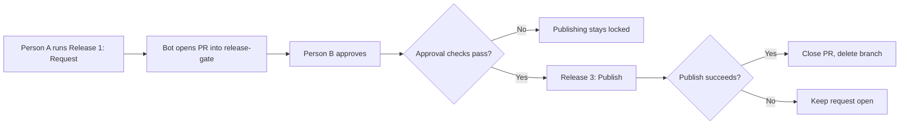

<h1 align="center">Release Gate</h1>

  <b>One person requests. Another approves. Merging is not a release strategy.</b>

 

 

A GitHub Actions release-approval template extracted from a working React Native / Expo setup. Someone requests a release, a different authorised person approves it, and only then can the publishing workflow run.

 

> [!IMPORTANT]
> **Born from production reality:** Forged from a real-world Poisoned Pipeline Execution (PPE) incident (OWASP CI/CD Top 10) where an attacker used a compromised credential to inject a rogue workflow and attempt to exfiltrate signing keys. In mobile CI/CD, a single token should never have the power to deploy backdoored binaries to user devices. Two authorized humans must sign off—always.  
> [Read the full threat model & retrospective →](THREAT_MODEL.md)

 

---

## What you get

- **Manual release requests** with app and store-track choices.
- **Audit trail:** a bot-opened pull request records every request.
- **Two-person rule:** named approvers, and nobody approves their own release.
- **Locked publishing:** the publish workflow is reachable only through the approval gate.
- **Trigger guard:** CI fails if a direct publish trigger is ever added.

 

---

## How it works

 

> [!WARNING]
> **Bring your own app; keep the gate.** This template ships a sample build and a dry-run publish step: no APK, AAB, or IPA, and nothing uploaded to a store. See the [production checklist](SETUP.md#before-you-give-it-the-store-keys) before enabling real uploads.
>
> **Avoid locking yourself out.** Add a second code owner **before** requiring code-owner approval, because PR authors cannot approve their own PRs. [Details →](SETUP.md#5-configure-code-owners-before-enforcing-reviews)

 

---

## Documentation

- [Setup guide](SETUP.md): adoption, permissions, using the gate, first-run checklist, and the production checklist.
- [Specification](SPEC.md): the exact gate rules and known limits.
- [Threat model](THREAT_MODEL.md): the incident behind the design and the defences it led to.

 

---

  <b>Call us old-fashioned</b>  
  We just think shipping a broken binary to thousands of devices...  
  Should take two people agreeing it's a good idea 

 

---

## License

MIT. See [LICENSE](LICENSE).
